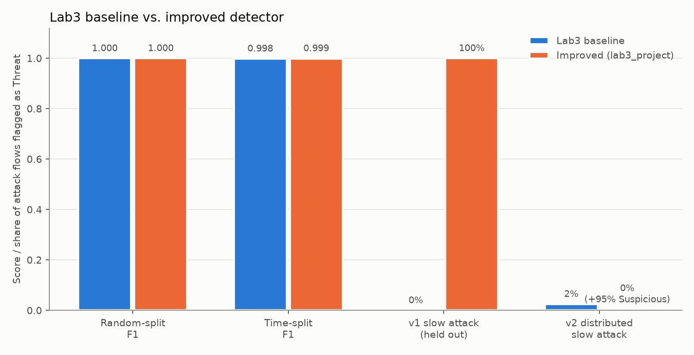
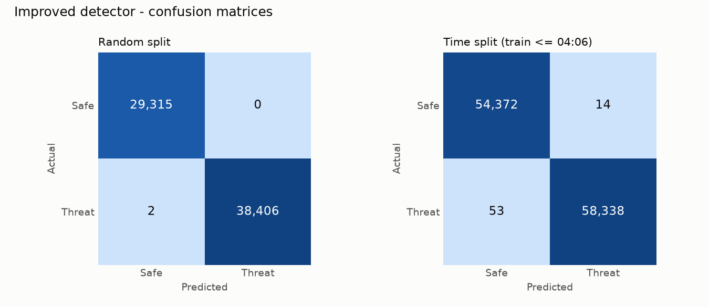
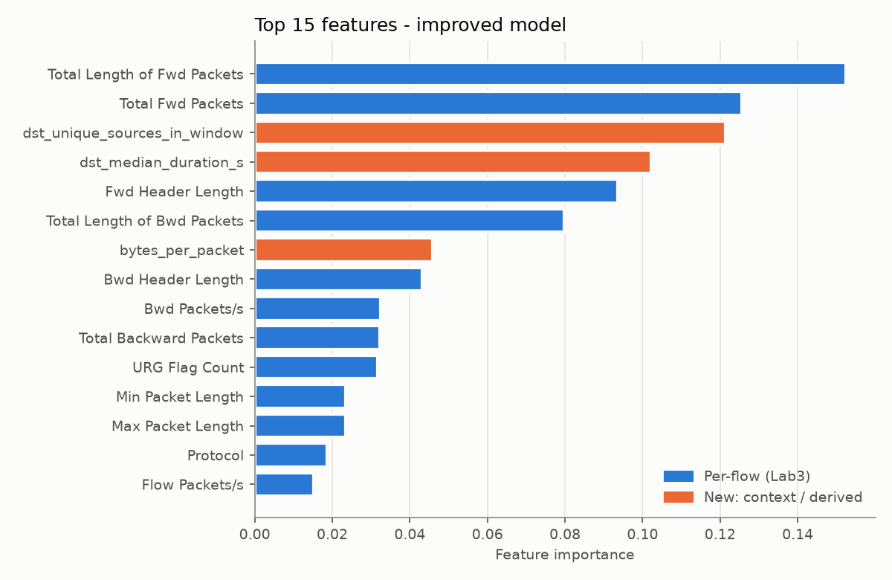

# Lab 3 Project — Improved IoT Botnet / DDoS Traffic Classifier

An improved version of **Lab3** (IoT Botnet Traffic Classifier). Same dataset
(CICIDS2017 Friday-afternoon DDoS capture, 225,745 flows), same Random Forest
family, but rebuilt to fix the weaknesses Lab3 itself exposed.

## 1. What was wrong with Lab3

| # | Weakness in Lab3 | Evidence |
|---|---|---|
| 1 | Each flow was judged **in isolation** | Lab3's own low-and-slow attack log (40 slow connections) was scored **0/40** detected |
| 2 | Only a **random** train/test split | The same 20-minute attack appears on both sides, so F1 ≈ 1.000 overstates real performance |
| 3 | Only two outcomes (Attack / Benign) | No "borderline" level; the analyst never sees near misses |
| 4 | No explanation for a verdict | The analyst can't tell *why* a flow was flagged |
| 5 | Flow-level view only | No answer to "which server is under attack?" |
| 6 | No tests, model saved without metadata | Hard to verify or reproduce |

## 2. Suggested improvements

**Implemented in this folder:**

1. **Context features.** Per (destination server, minute) the model sees the
   number of distinct clients, the number and share of long, near-idle
   connections, and the median connection length. IP addresses are used only
   to group flows and are never model inputs.
2. **Training-only synthetic slow-attack augmentation.** 351 synthetic
   slow-DoS flows go into training minutes only. Their parameters deliberately
   differ from the held-out attack logs, so the test is not memorised.
3. **Calibrated rule layer (hybrid detection).** A connection is flagged when
   it is long and near-idle *and* its server has ≥ 23 such connections in the
   same minute. 23 is one more than the highest count benign training traffic
   ever reached (22), so the rule produces zero false positives on the
   training data by construction.
4. **Three verdict tiers with reasons:** Threat / Suspicious / Safe, each with
   a plain-language reason (for example *"Slow-connection flood: 40 long,
   near-idle connections to this server in one minute (benign max: 22)"*).
5. **Honest evaluation.** Besides the random split there is a **time split**
   (train ≤ 04:06, test after), an evaluation on **small sampled logs**, and
   two **held-out attack logs**.
6. **Per-server summary** in the dashboard showing which server is being hit
   and how.
7. **Unit tests** (`pytest`) for the feature pipeline and the detector logic.
   The trained bundle also stores its metrics, rule threshold and library
   versions.

**Further ideas (not implemented):**

- Retrain on a real IoT-botnet dataset (N-BaIoT, Bot-IoT, CICIoT2023). CICIDS2017 is enterprise traffic.
- Measure true connection concurrency from second-level timestamps, not one-minute windows.
- Calibrate probabilities (Platt or isotonic) so that "p = 0.4" means 40 %.
- Add SHAP values to the per-flow explanations.
- Add an analyst feedback loop: reviewed Suspicious flows become new labelled training data.
- Add a per-source context view (scanners, single bots) alongside the per-server view.

## 3. Results



| Evaluation | Lab3 baseline | Improved |
|---|---|---|
| Random split — F1 / FP / FN | 0.9997 / 7 / 18 | **1.0000 / 0 / 2** |
| Time split — F1 / FP / FN | 0.9983 / 115 / 79 | **0.9994 / 14 / 53** |
| Time split as small sampled logs — FP / FN | 115 / 79 (per-flow, unaffected) | 6 / 98 |
| v1 low-and-slow attack, 1 server (held out) | 0 / 40 | **40 / 40 Threat** |
| v2 slow attack spread over 4 servers × 10 min | 1 / 40 | 0 Threat, **38 / 40 Suspicious** |
| Demo sample log (30 DDoS + 30 benign) | — | 30 Threat, 30 Safe (all correct) |




The **time split** is the number to trust. The random-split score is inflated
for both models.

## 4. Lessons learned while building it

Three issues showed up during development and were fixed. Each one is a
lesson in itself.

**a) Shortcut learning.** The first version also had raw volume counters
(flows per server and per client per minute). Under the time split the model
learned "an attack sends ≥ ~2,000 flows/minute". When the DDoS faded to ~1,350
flows/minute in its last minute, the model missed **1,348** attack flows
(Lab3 missed 79). Removing the counters fixed it (53 misses). The remaining
context features describe the *shape* of the traffic, not its loudness.

**b) Context features assume a complete capture.** Context is computed within
the uploaded log. A 60-row sampled log has about one flow per server per
minute, so every server looks idle. Before the fix the model labelled **0/30**
real DDoS flows as Threat in the demo log. With the time-split test cut into
small logs, it missed **55,274** attack flows. Fix: *sparse-view
augmentation*. 2,000 training flows are re-cut into small pseudo-logs (30–600
flows) and their context is recomputed, so the model also learns what sampled
logs look like. A sweep picked the size:

| Sparse rows | Full capture FP / FN | Sampled logs FP / FN | Demo DDoS → Threat |
|---|---|---|---|
| 0 | 6 / 53 | 5 / **55,274** | 0 / 30 |
| **2,000** (chosen) | 14 / 53 | 6 / 98 | **30 / 30** |
| 5,000 | 23 / 54 | 15 / 86 | 30 / 30 |
| 15,000 | 112 / 56 | 110 / 69 | 30 / 30 |

More sparse data makes the model lean on per-flow features again, and the false
positives grow back toward Lab3's 115.

**c) The arms race (v1 → v2).** The detector catches v1 because 40 slow
connections hit one server in one minute. No benign server ever reaches that.
v2 (`scripts/make_evasion_v2.py`) spreads the same connections thin, at most
one per server per minute. The rule no longer fires. The model still rates
38/40 flows as **Suspicious**, but none as Threat: a **partial bypass**. The
trade-off for the attacker is that a slow-connection DoS works by exhausting
*one* server's connection pool. Spread this thin, it barely loads any server.
The defence has pushed the attacker into a much weaker attack.

## 5. How to run

```bash
pip install -r requirements.txt
python scripts/make_evasion_v2.py   # (already generated) v2 attack log
python -m src.train                 # downloads the 35 MB CSV if missing, trains, writes models/ and outputs/
streamlit run app.py                # dashboard: demo-log buttons, upload, per-server and per-flow verdicts
pytest                              # 11 unit tests
```

The dashboard accepts uploads up to 500 MB (`.streamlit/config.toml`).

## 6. Project layout

```
lab3_project/
├── app.py                  Streamlit dashboard
├── src/
│   ├── config.py           paths, feature list, thresholds
│   ├── data.py             download / load CICIDS2017
│   ├── features.py         per-flow, derived and context features
│   ├── augment.py          synthetic slow-attack bursts (training only)
│   ├── detector.py         hybrid detector, verdicts, reasons, server summary
│   └── train.py            training, all evaluations, charts
├── scripts/make_evasion_v2.py
├── data/                   sample log, v1 and v2 attack logs (raw CSV is downloaded)
├── outputs/                metrics.json and charts
└── tests/                  pytest unit tests
```
